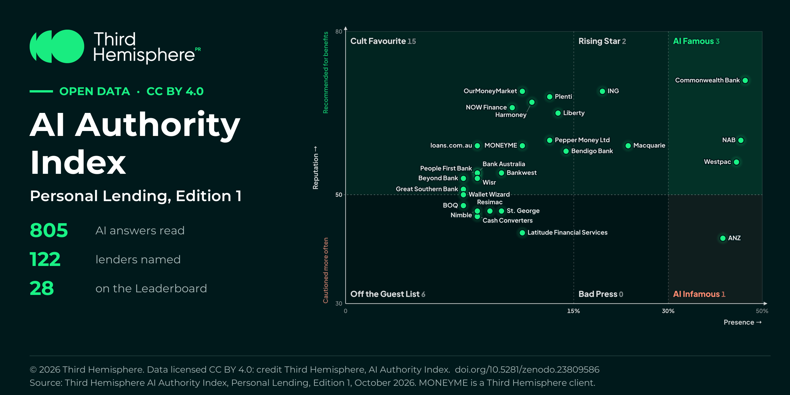

# AI Authority Index: open data

The published results of the **AI Authority Index**, Third Hemisphere's index of how AI engines (ChatGPT, Claude, Copilot, Gemini, and Perplexity) describe, recommend, and source the companies in an Australian market. The index measures **AI visibility**: how often AI search engines and assistants name, recommend, and cite each company, which is the outcome AI SEO and generative engine optimisation (GEO) aim to improve.

Every edition is published under CC BY 4.0. You may share and adapt the data for any purpose, provided you credit Third Hemisphere.

## Editions

| Market | Edition | Published | Data | DOI | Edition page |
|---|---|---|---|---|---|
| Personal Lending | Edition 1 | 19 October 2026 | [results.csv](editions/personal-lending/edition-1/results.csv) | [10.5281/zenodo.23809586](https://doi.org/10.5281/zenodo.23809586) | [thirdhemisphere.agency/ai-authority-index/personal-lending](https://thirdhemisphere.agency/ai-authority-index/personal-lending) |

Each edition folder has its own README describing every column.

## Always current: the live data

These files are snapshots. The current results, every market's Standing Reports, and each company's CRISP score and history are live at https://thirdhemisphere.agency/ai-authority-index/data:

- JSON API: https://thirdhemisphere.agency/api/public/v1 (OpenAPI: https://thirdhemisphere.agency/api/public/v1/openapi.json)
- Feeds of new editions, new markets, and score changes: https://thirdhemisphere.agency/ai-authority-index/feed.xml (RSS), https://thirdhemisphere.agency/ai-authority-index/feed.atom (Atom), https://thirdhemisphere.agency/ai-authority-index/feed.json (JSON Feed)
- MCP server for AI agents (Claude, ChatGPT, Cursor): https://thirdhemisphere.agency/mcp

## How the index is measured

The AI Authority Index is measured with CRISP, which scores how the AI engines buyers use treat a company on five factors: Consensus, Reputation, Influence, Source, and Presence. Each edition is read from the AI answers to buyer questions that name no company.

- How CRISP works: https://thirdhemisphere.agency/crisp-methodology
- All editions: https://thirdhemisphere.agency/ai-authority-index
- Check any company for free: https://thirdhemisphere.agency/ai-authority-check

These are results only. The data describes what AI engines said in each edition's answers; it does not explain why, and a low reading passes no judgement on a company.

## About the author

Jeremy Liddle is the Executive Chair of Third Hemisphere and the author of the AI Authority Index. He designed CRISP, the proprietary technology and methodology behind the Index, and leads its development. More: https://thirdhemisphere.agency/ai-authority-index/author

## About Third Hemisphere

Third Hemisphere is the integrated PR, marketing, AI Authority & Visibility, and investor relations agency helping ambitious companies grow, from Sydney, Melbourne, and Singapore. Founded in Sydney in 2014, it has worked with over 150 clients and secured over 20,000 media placements. It became a Certified B Corporation in April 2026 and publishes the AI Authority Index. https://thirdhemisphere.agency

## How to cite

Third Hemisphere, AI Authority Index, Personal Lending, Edition 1, published 19 October 2026, https://doi.org/10.5281/zenodo.23809586.

GitHub's "Cite this repository" button reads [CITATION.cff](CITATION.cff).

## Licence

[Creative Commons Attribution 4.0 International (CC BY 4.0)](https://creativecommons.org/licenses/by/4.0/). See [LICENSE.md](LICENSE.md).
